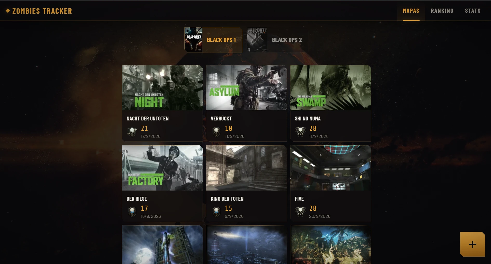
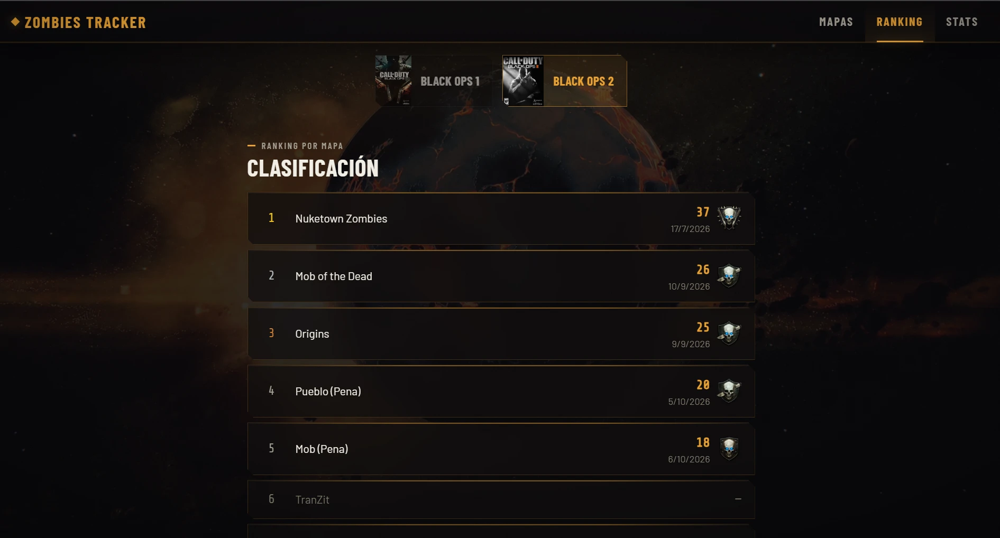
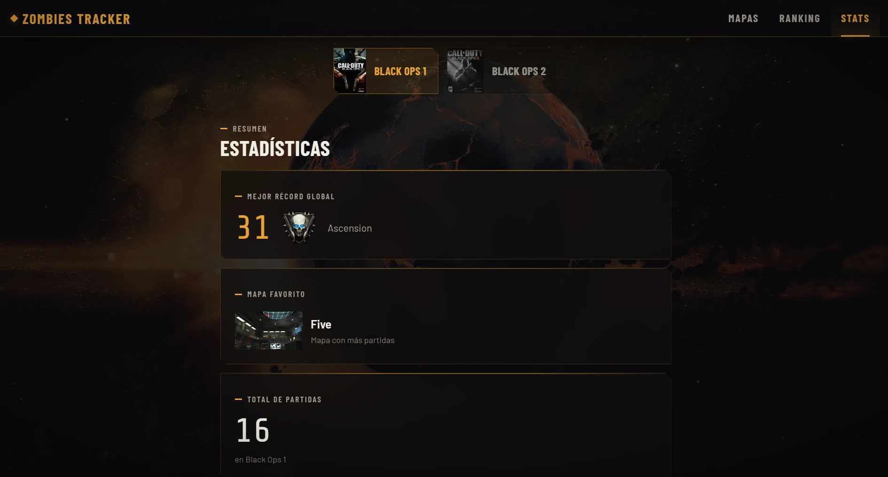

# 🧟 Zombies Tracker

Una web privada para llevar el registro de tus récords de rondas en todos los mapas de zombies de **Black Ops 1** y **Black Ops 2**. Hecha para quien se toma en serio sus récords.




---

## Capturas

| Ranking | Estadísticas |
|---------|--------------|
|  |  |

---

## Funcionalidades

- **Selector de juego**: cambia entre Black Ops 1 y Black Ops 2 con un toque. La app recuerda el último que elegiste.
- **Cuadrícula de mapas**: cada mapa aparece en una tarjeta con su portada, tu récord y la fecha en que lo conseguiste.
- **Registro de partidas**: apunta la ronda alcanzada, el mapa, la fecha y una nota opcional. Las partidas se pueden editar y borrar.
- **Celebración de récords**: cuando superas tu mejor ronda en un mapa, la app lo anuncia con una animación.
- **Iconos de rango de BO2**: cada partida muestra el rango que corresponde a la ronda alcanzada.
- **Detalle de mapa**: récord actual, gráfica de progreso e historial completo de partidas.
- **Mejor partida del mes**: destacada en la pantalla principal.
- **Ranking**: los mapas ordenados por tu ronda más alta.
- **Estadísticas**: mejor récord global, mapa favorito y total de partidas por juego.
- **Vídeos de YouTube**: una tarea diaria enlaza automáticamente tus últimos vídeos del canal con las partidas correspondientes.
- **Instalable en el móvil (PWA)**: se puede añadir a la pantalla de inicio y abrir a pantalla completa, como una app.
- **Acceso con contraseña** y diseño **adaptado a móvil y escritorio**.

---

## Mapas incluidos

**Black Ops 1**: Nacht der Untoten, Verrückt, Shi No Numa, Der Riese, Kino der Toten, Five, Ascension, Call of the Dead, Shangri-La y Moon.

**Black Ops 2**: TranZit, Bus Depot, Granja, Pueblo, Nuketown Zombies, Die Rise, Mob of the Dead, Buried y Origins, más los modos Pena de Granja, Pueblo, Mob y Buried.

---

## Tecnologías

| Capa | Tecnología |
|------|------------|
| Frontend | React 18 + TypeScript + Vite |
| Estilos | Tailwind CSS 3 |
| Animaciones | anime.js |
| Base de datos | Supabase (PostgreSQL) |
| Hosting y cron | Vercel |
| Vídeos | YouTube Data API v3 |
| Tests | Vitest + Testing Library |
| Fuentes | Barlow, Barlow Condensed y Share Tech Mono (Google Fonts) |
| Imágenes | CDN de la wiki de Call of Duty en Fandom |

---

## Ejecutar en local

**1. Clona el repositorio e instala las dependencias**

```bash
git clone https://github.com/DDevjourney/zombies-tracker.git
cd zombies-tracker
npm install
```

**2. Prepara Supabase**

Crea un proyecto en [supabase.com](https://supabase.com) y ejecuta esto en el SQL Editor:

```sql
create table sessions (
  id uuid primary key default gen_random_uuid(),
  game text not null,
  map text not null,
  round integer not null,
  played_at date not null,
  created_at timestamptz default now()
);
```

Después aplica las migraciones de [`supabase/migrations`](supabase/migrations), que añaden las columnas de vídeo y de notas.

**3. Configura las variables de entorno**

Copia `.env.example` como `.env` y rellena los valores:

```
VITE_SUPABASE_URL=url_de_tu_proyecto_supabase
VITE_SUPABASE_ANON_KEY=tu_clave_anon_de_supabase
VITE_APP_PASSWORD=la_contraseña_que_elijas
```

**4. Arranca el servidor de desarrollo**

```bash
npm run dev
```

### Otros comandos

| Comando | Qué hace |
|---------|----------|
| `npm run build` | Compila la versión de producción |
| `npm test` | Lanza los tests en modo vigilancia |
| `npm run test:coverage` | Lanza los tests una vez con informe de cobertura |

---

## Desplegar en Vercel

1. Sube el repositorio a GitHub.
2. Impórtalo en [vercel.com](https://vercel.com).
3. Añade las variables de entorno en los ajustes del proyecto de Vercel.
4. Despliega. A partir de ahí, cada `git push` a `main` vuelve a desplegar automáticamente.

### Sincronización con YouTube (opcional)

La función [`api/sync-youtube.ts`](api/sync-youtube.ts) se ejecuta cada día a las 3:00 (UTC) mediante el cron definido en [`vercel.json`](vercel.json). Consulta los últimos vídeos de tu canal y los asigna a las partidas recientes que aún no tienen vídeo. Necesita estas variables, que solo existen en el servidor y por eso no llevan el prefijo `VITE_`:

| Variable | Descripción |
|----------|-------------|
| `YOUTUBE_API_KEY` | Clave de Google Cloud con YouTube Data API v3 activada |
| `YOUTUBE_CHANNEL_ID` | ID de tu canal (empieza por `UC`) |
| `SUPABASE_URL` | La misma URL que `VITE_SUPABASE_URL` |
| `SUPABASE_SERVICE_ROLE_KEY` | Clave `service_role` de Supabase (nunca la `anon`) |
| `CRON_SECRET` | Cadena aleatoria con la que Vercel autentica el cron |

---

## Sistema de rangos de BO2

| Ronda | Rango |
|-------|-------|
| 1 – 6 | 🦴 Hueso |
| 7 – 9 | 🦴🦴 Huesos cruzados |
| 10 – 14 | 💀 Calavera |
| 15 – 19 | 💀 Calavera (ojos azules) |
| 20 – 22 | 💀🔪 Calavera y cuchillo |
| 23 – 26 | 💀🔪 Calavera y cuchillo (ojos azules) |
| 27 – 29 | 💀🔫 Calavera y escopetas |
| 30+ | 💀🔫 Calavera y escopetas (ojos azules) |
